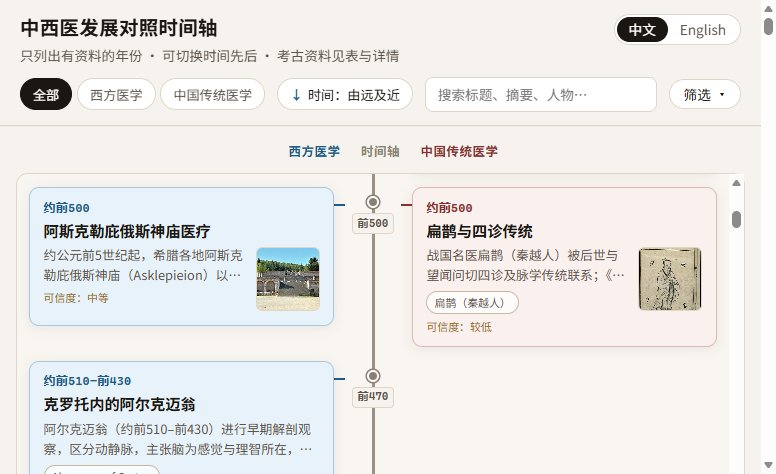
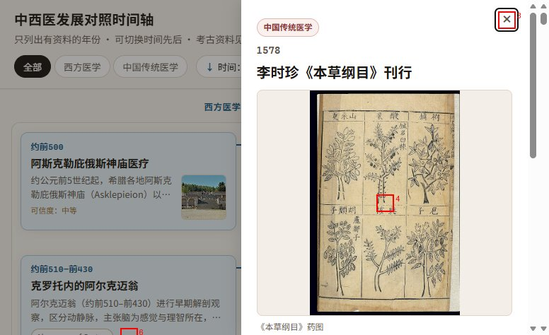
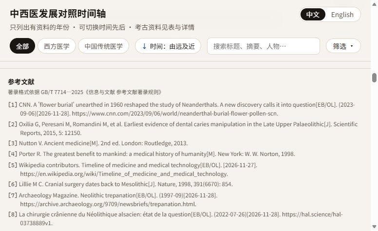

# 中西医发展对照时间轴（med-timeline）

一个在浏览器中阅读的静态网站，把西方医学与中国传统医学的历史事件放在同一条时间轴上左右对照：左侧为西方医学，右侧为中国传统医学，中间为年份。数据从史前延续到约 2000 年，共 441 条事件（西方医学 264 条，中国传统医学 177 条），内容取材于史书、医籍、名医传记、出土文献、原始科学论文和博物馆资料。每条事件都可展开查看人物、著作、来源、配图与参考文献。

本站只呈现医学史资料，不提供诊疗、病历、预约或账号功能，也不收集访问者数据。

## 时间轴

纵轴只列出有资料的年份：每个有事件的年份占一行，年份标在中轴上，当年的西方医学事件在左、中国传统医学事件在右；同一年同一侧有多条事件时依次叠放。没有任何事件的年份不会出现在轴上。有代表性图片的事件，卡片右侧会显示缩略图。



### 时间排序

工具栏中的排序按钮可在「由远及近」（升序，从史前开始）与「由近及远」（降序，从最近的年份开始）之间切换，所选顺序保存在浏览器中。

### 筛选与搜索

- 侧别：全部、西方医学、中国传统医学
- 搜索：匹配标题、摘要、人物、著作、标签、来源和考古字段
- 高级筛选：按标签组合筛选，或只看有考古证据的条目

筛选后时间轴只保留仍有事件的年份。

### 事件详情与配图

点击卡片打开详情面板，显示年份、配图、摘要、相关人物、相关著作、标签、来源、可信度，以及该条对应的参考文献编号，点击编号可跳到页面底部的文献条目。

共有 59 条事件配有代表性图片，包括古籍书页、出土文物、原著插图、人物肖像和历史照片，均来自 Wikimedia Commons，许可为公有领域或知识共享（CC0、CC BY、CC BY-SA）。图下注明作者、许可证，并链接到原始文件页。图片从 Wikimedia 在线加载，网络无法访问时会自动隐藏，不影响阅读文字内容。



## 考古发现

时间轴下方的「考古发现」表汇总 42 条以出土文物或遗址为主要依据的条目，列出侧别、历史年、发现时间、发现地、内容、收藏地、是否开放和地址。历史年是事件在轴上的年代，发现时间是文物出土或面世的时间，两者分列。收藏地、开放情况与地址仅在有博物馆官网或权威资料时填写，其余留空。点击任一行可打开该条详情。


## 参考文献

页面底部以小字号列出全站 223 条参考文献，著录格式依据 GB/T 7714—2025《信息与文献 参考文献著录规则》，按事件在时间轴上首次引用的先后顺序编码。文献涵盖正史与古医籍点校本、医学通史、简帛整理本、期刊论文、博物馆与机构网页，详情面板中的编号与此列表一一对应。



## 中英文切换

标题行右侧的「中文 / English」切换整页界面与事件正文，选择保存在浏览器中，默认中文。


## 使用方式

网站由一台 nginx 容器提供，默认端口 3007：

```sh
cp .env.example .env
docker compose up -d --build
```

浏览器打开 `http://<主机 IP>:3007/` 即可。时间轴数据保存在 `data/timeline.json`，修改后刷新浏览器即可生效；字段说明见 [data/README-data.md](data/README-data.md)。部署、升级、备份与发版的完整说明见 [docs/MAINTAINING.md](docs/MAINTAINING.md)。

## 许可

代码以 MIT License 发布，见 [LICENSE](LICENSE)。配图版权归各自作者，按 Wikimedia Commons 文件页所示许可使用。页面页脚署名 Li Yuxian TCM Studio。

<sub>

### 参考文献

[2] Oxilia G, Peresani M, Romandini M, et al. Earliest evidence of dental caries manipulation in the Late Upper Palaeolithic[J]. Scientific Reports, 2015, 5: 12150.<br>
[3] Nutton V. Ancient medicine[M]. 2nd ed. London: Routledge, 2013.<br>
[4] Porter R. The greatest benefit to mankind: a medical history of humanity[M]. New York: W. W. Norton, 1998.<br>
[9] 李经纬, 林昭庚. 中国医学通史: 古代卷[M]. 北京: 人民卫生出版社, 2000.<br>
[24] Harper D J. Early Chinese medical literature: the Mawangdui medical manuscripts[M]. London: Kegan Paul International, 1998.<br>
[51] Needham J, Lu G D. Celestial lancets: a history and rationale of acupuncture and moxa[M]. Cambridge: Cambridge University Press, 1980.<br>
[77] Unschuld P U. Medicine in China: a history of ideas[M]. Berkeley: University of California Press, 1985.<br>
[201] Tu Youyou. The discovery of artemisinin (qinghaosu) and gifts from Chinese medicine[J]. Nature Medicine, 2011, 17(10): 1217-1220.<br>
[223] 国家市场监督管理总局, 国家标准化管理委员会. 信息与文献 参考文献著录规则: GB/T 7714—2025[S]. 北京: 中国标准出版社, 2025.<br>
完整的 223 条文献随数据保存在 data/timeline.json 的 references 字段中，并显示在网页底部。

</sub>
