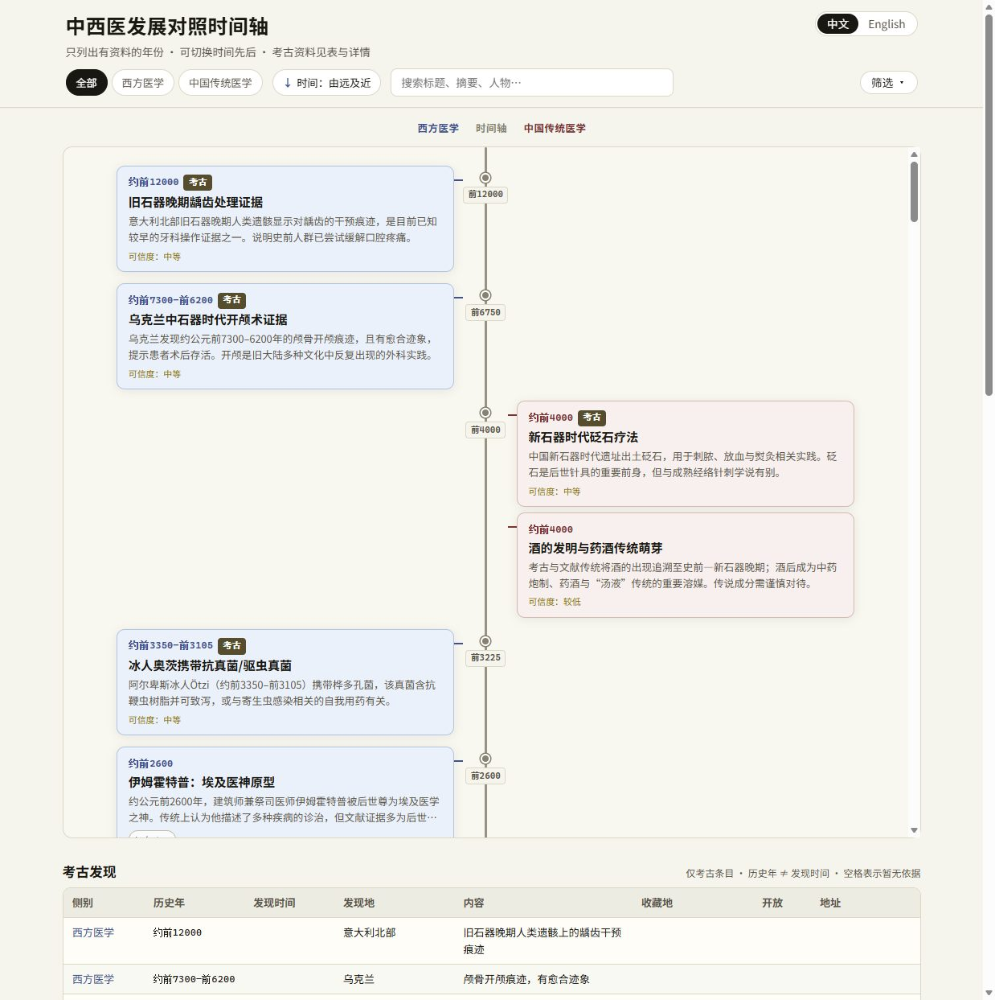
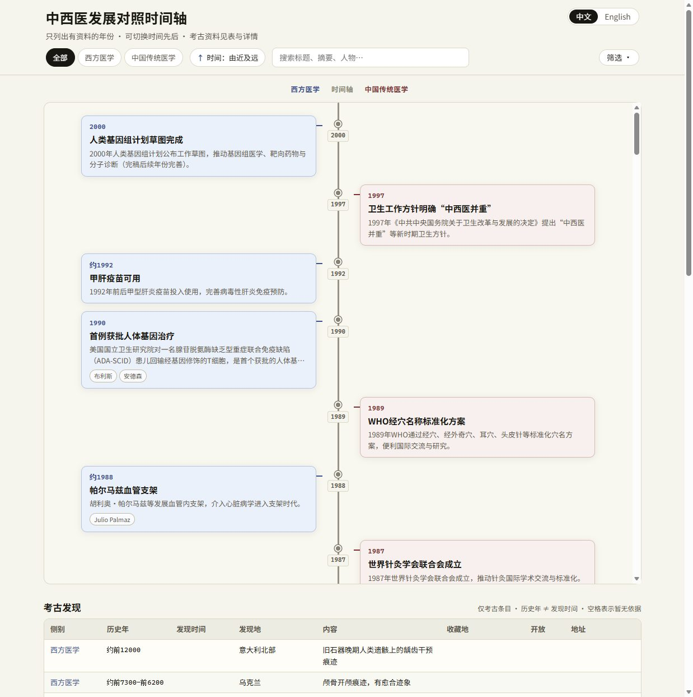
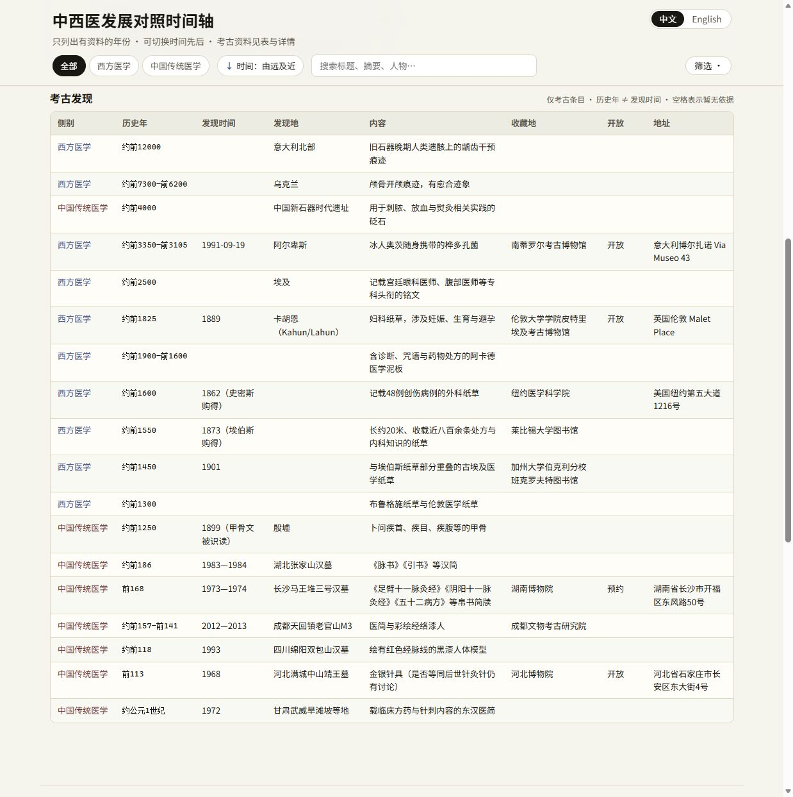
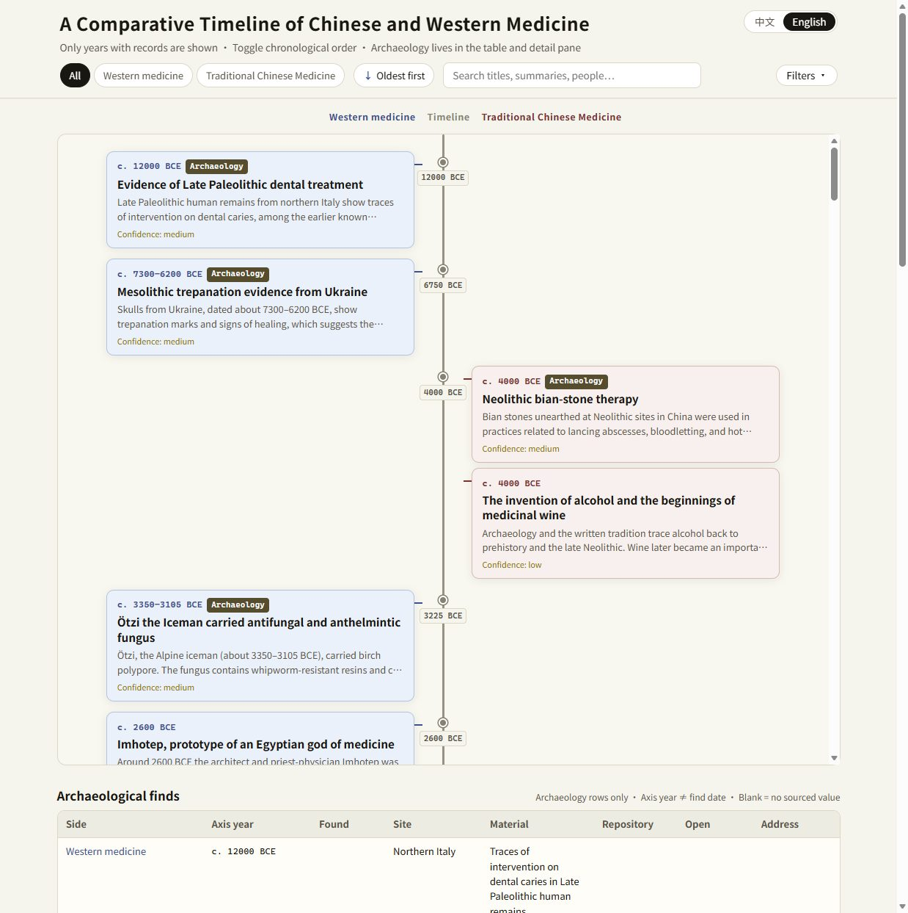

# 中西医发展对照时间轴（med-timeline）

一个在浏览器中阅读的静态网站，把西方医学与中国传统医学的历史事件放在同一条时间轴上左右对照：左侧为西方医学，右侧为中国传统医学，中间为年份。数据从史前延续到约 2000 年，共 276 条事件（西方医学 164 条，中国传统医学 112 条），每条都可展开查看人物、著作、来源与参考文献。

本站只呈现医学史资料，不提供诊疗、病历、预约或账号功能，也不收集访问者数据。

## 时间轴

纵轴只列出有资料的年份：每个有事件的年份占一行，年份标在中轴上，当年的西方医学事件在左、中国传统医学事件在右；同一年同一侧有多条事件时依次叠放。没有任何事件的年份不会出现在轴上，阅读时不会遇到大段空白。



### 时间排序

工具栏中的排序按钮可在「由远及近」（升序，从史前开始）与「由近及远」（降序，从最近的年份开始）之间切换。切换后时间轴从新的第一行开始显示；所选顺序保存在浏览器中，下次打开时保持不变。



### 筛选与搜索

- 侧别：全部、西方医学、中国传统医学
- 搜索：匹配标题、摘要、人物、著作、标签、来源和考古字段
- 高级筛选：按标签组合筛选，或只看有考古证据的条目

筛选后时间轴只保留仍有事件的年份。

### 事件详情

点击卡片打开详情面板，显示年份、摘要、相关人物、相关著作、标签、来源、可信度，以及该条对应的参考文献编号。点击编号会跳到页面底部对应的文献条目。可信度为「中等」或「较低」的条目，卡片上会直接标出。

## 考古发现

时间轴下方的「考古发现」表汇总所有以出土文物或遗址为主要依据的条目，列出侧别、历史年、发现时间、发现地、内容、收藏地、是否开放和地址。历史年是事件在轴上的年代，发现时间是文物出土或面世的时间，两者分列。没有可靠来源的单元格留空。点击任一行可打开该条详情。



## 参考文献

页面底部以小字号列出全站参考文献，著录格式依据 GB/T 7714—2025《信息与文献 参考文献著录规则》，按顺序编码。文献涵盖医学通史、中国医学史、考古简帛整理本与原始科学论文，详情面板中的编号与此列表一一对应。


## 中英文切换

标题行右侧的「中文 / English」切换整页界面与事件正文，选择保存在浏览器中，默认中文。个别条目暂无英文时保留中文，并标注「暂无英文」。



## 使用方式

网站由一台 nginx 容器提供，默认端口 3007：

```sh
cp .env.example .env
docker compose up -d --build
```

浏览器打开 `http://<主机 IP>:3007/` 即可。时间轴数据保存在 `data/timeline.json`，修改后刷新浏览器即可生效；字段说明见 [data/README-data.md](data/README-data.md)。部署、升级、备份与发版的完整说明见 [docs/MAINTAINING.md](docs/MAINTAINING.md)。

## 许可

MIT License，见 [LICENSE](LICENSE)。页面页脚署名 Li Yuxian TCM Studio。

<sub>

### 参考文献

[1] 李经纬, 林昭庚. 中国医学通史: 古代卷[M]. 北京: 人民卫生出版社, 2000.<br>
[2] 甄志亚. 中国医学史[M]. 上海: 上海科学技术出版社, 1997.<br>
[3] Wong K C, Wu L T. History of Chinese medicine[M]. 2nd ed. Shanghai: National Quarantine Service, 1936.<br>
[4] Porter R. The greatest benefit to mankind: a medical history of humanity[M]. New York: W. W. Norton, 1998.<br>
[5] Nutton V. Ancient medicine[M]. 2nd ed. London: Routledge, 2013.<br>
[6] 中华人民共和国国务院新闻办公室. 中国的中医药[R]. 北京: 中华人民共和国国务院新闻办公室, 2016.<br>
[7] 国家市场监督管理总局, 国家标准化管理委员会. 信息与文献 参考文献著录规则: GB/T 7714—2025[S]. 北京: 中国标准出版社, 2025.<br>
完整的 36 条文献列表随数据保存在 data/timeline.json 的 references 字段中，并显示在网页底部。

</sub>
